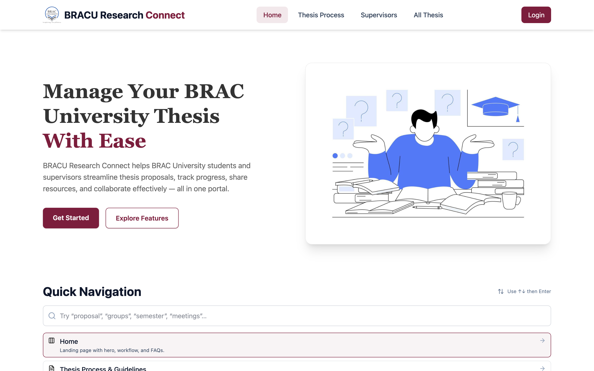
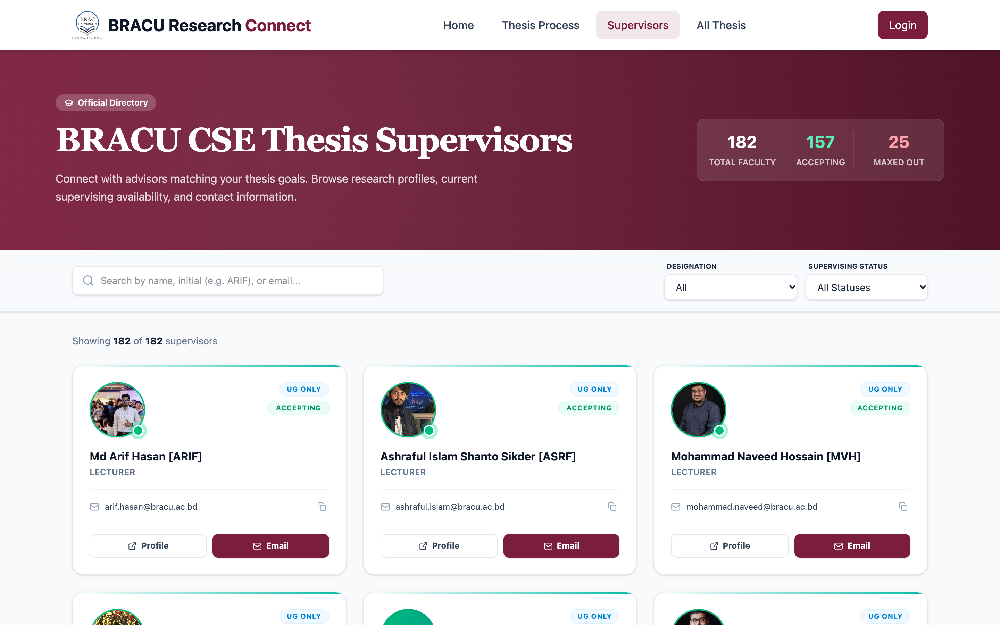
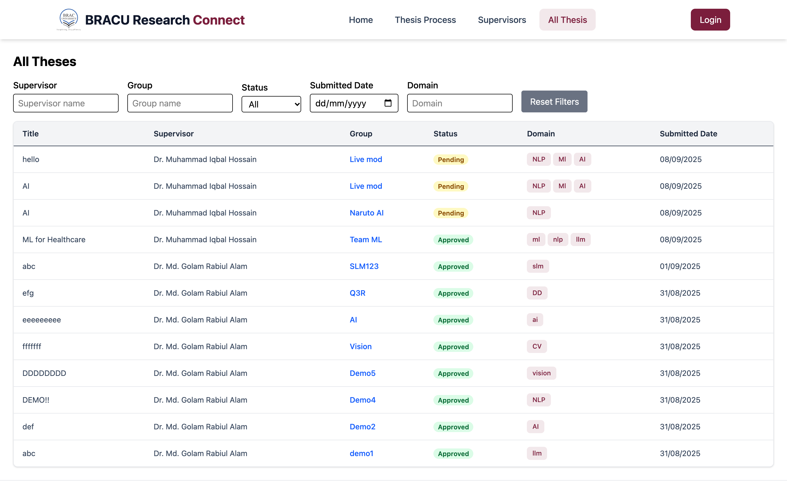

# BRACU Research Thesis Portal

**Full-Stack University Thesis Management & Supervision Workflow Platform**


A monorepo containing both the React frontend and Express/MongoDB backend built to streamline the academic thesis lifecycle at BRAC University—connecting **Students**, **Supervisors**, and **Admins** across group formation, proposal review, arXiv literature discovery, supervision scheduling, and archival.

- **Live Client:** [https://bracu-research-connect.web.app](https://bracu-research-connect.web.app)
- **Live Server API:** [https://bracu-research-server-eta.vercel.app](https://bracu-research-server-eta.vercel.app)

---

## Screenshots

| Portal Home | Supervisor Directory | Thesis Archive |
| :---: | :---: | :---: |
|  |  |  |

---

## Core Features

### Student Workflow
- **Thesis Group Formation**: Create teams of 1–5 members, send team invitations, and coordinate group membership.
- **Proposal Submissions**: Submit structured research abstracts, domain classifications, and supporting attachments.
- **arXiv Paper Lookup & Bookmarks**: Search and save academic preprints directly inside the portal via the backend arXiv XML integration.
- **Meeting Tracker**: View scheduled evaluation sessions and supervisor feedback.

### Supervisor Workflow
- **Proposal Triage**: Review incoming student group proposals and accept or reject supervision requests.
- **Paper Recommendations**: Curate and push arXiv papers directly to assigned thesis teams.
- **Evaluation & Scheduler**: Schedule supervision meetings and attach written milestone feedback.

### Admin Workflow
- **Semester Lifecycle Setup**: Configure semester timelines, submission milestones, and rollover cohorts.
- **Supervisor Allocation**: Manually match and balance thesis groups across faculty supervisors.
- **Global Announcements & Role Control**: Broadcast university-wide notices and promote or manage `Student`, `Supervisor`, and `Admin` accounts.

---

## Tech Stack

| Layer | Technology |
| :--- | :--- |
| **Frontend** | React 19, Vite 7, React Router 7, Tailwind CSS 4, DaisyUI 5, Lucide React, Lottie React, React Toastify, SweetAlert2 |
| **Backend API** | Node.js, Express 5.1, Compression, CORS, Node-Cache, `xml2js` (arXiv feed parsing) |
| **Database & Auth** | MongoDB Atlas (native `mongodb` driver), Firebase Authentication |
| **Deployment** | Firebase Hosting (`firebase.json`) & Vercel (`vercel.json`) |

---

## Project Structure

```text
BRAC-University-Thesis-Portal/
├── BRACU-Research-Thesis-client-main/   # React + Vite frontend
│   ├── public/
│   ├── src/
│   │   ├── components/                  # Reusable portal UI elements
│   │   ├── contexts/                    # Auth & user context providers
│   │   ├── firebase/                    # Firebase client configuration
│   │   ├── layouts/                     # Root layout wrappers
│   │   ├── pages/                       # Role-specific views & dashboards
│   │   ├── Private/                     # Authenticated route guards
│   │   └── routers/                     # React Router route definitions
│   ├── firebase.json
│   ├── vercel.json
│   └── package.json
├── BRACU-Research-server-main/          # Express + MongoDB backend
│   ├── index.js                         # REST API & arXiv proxy endpoints
│   ├── vercel.json
│   └── package.json
└── docs/screenshots/
```

---

## Local Setup

### Prerequisites

- Node.js 18+
- MongoDB Atlas cluster & Firebase project

### 1. Backend Server Setup

```bash
git clone https://github.com/IFTI-KAR/BRAC-University-Thesis-Portal.git
cd BRAC-University-Thesis-Portal/BRACU-Research-server-main
npm install
```

Create `BRACU-Research-server-main/.env`:

```env
DB_USER=your_mongodb_username
DB_PASS=your_mongodb_password
```

Run the server:

```bash
node index.js
```

### 2. Frontend Client Setup

In a separate terminal:

```bash
cd BRACU-Research-Thesis-client-main
npm install
```

Create `BRACU-Research-Thesis-client-main/.env`:

```env
VITE_FIREBASE_API_KEY=your_firebase_api_key
VITE_FIREBASE_AUTH_DOMAIN=your_project.firebaseapp.com
VITE_FIREBASE_PROJECT_ID=your_project_id
VITE_FIREBASE_STORAGE_BUCKET=your_project.appspot.com
VITE_FIREBASE_MESSAGING_SENDER_ID=your_sender_id
VITE_FIREBASE_APP_ID=your_app_id
```

Start the Vite dev server:

```bash
npm run dev
```
